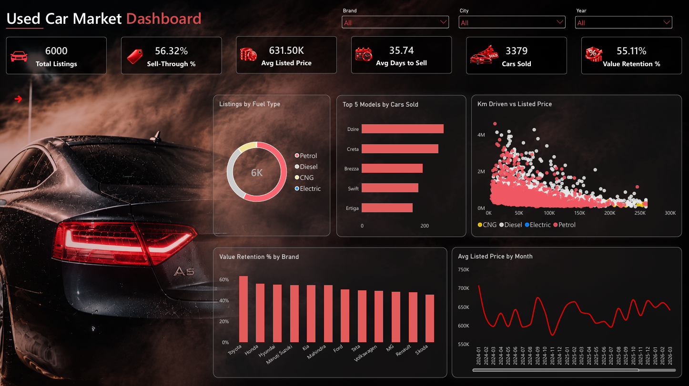

# India Used Car Market Dashboard | Power BI

An interactive two-page Power BI dashboard that analyses used car prices, demand and resale value across 18 Indian cities.



## About the data
The dataset is **synthetic**. I generated 6,000 listings (January 2024 to September 2026) that follow realistic market patterns, such as price falling with vehicle age and mileage. It was created for practising data modelling, DAX and dashboard design, so the insights apply to this dataset only and not to the real market.

## Data model (star schema)
| Table | Type | Contents |
|---|---|---|
| `Fact_Listings` | Fact | One row per listing: price, km driven, owner type, status, days on market |
| `Dim_Car` | Dimension | Brand, model, body type, fuel, transmission, new price |
| `Dim_City` | Dimension | City, state, region, tier, latitude and longitude |

Relationships are one-to-many (single direction): `Dim_Car[Car_ID]` -> `Fact_Listings[Car_ID]` and `Dim_City[City_ID]` -> `Fact_Listings[City_ID]`.

## DAX measures
```DAX
Total Listings = COUNTROWS(Fact_Listings)

Cars Sold = CALCULATE([Total Listings], Fact_Listings[Listing_Status] = "Sold")

Sell-Through % = DIVIDE([Cars Sold], [Total Listings])

Avg Listed Price = AVERAGE(Fact_Listings[Listed_Price_INR])

Avg Days to Sell = AVERAGE(Fact_Listings[Days_On_Market])

Value Retention % =
DIVIDE([Avg Listed Price], AVERAGEX(Fact_Listings, RELATED(Dim_Car[New_Price_INR])))
```
Calculated columns: `Vehicle Age`, `Month`, `Year`.

## Dashboard contents
- **KPIs:** Total Listings, Sell-Through %, Avg Listed Price, Avg Days to Sell, Cars Sold, Value Retention %
- **Visuals:** Top 5 Models by Cars Sold, Listings by Fuel Type, Km Driven vs Listed Price, Value Retention % by Brand, Avg Listed Price by Month
- **Slicers:** Brand, City, Year
- **Page 2:** Key Insights

## Files
| File | Description |
|---|---|
| `used car sales.pbix` | Power BI report (open in Power BI Desktop) |
| `Fact_Listings.csv`, `Dim_Car.csv`, `Dim_City.csv` | Source data |
| `used car sales.pdf` | PDF export of both pages |
| `dashboard.png` | Dashboard preview image |

## Tools
Power BI Desktop, Power Query, DAX, data modelling (star schema)

## Author
**Rohitha PP** | [LinkedIn](https://www.linkedin.com/in/rohitha-pp)
